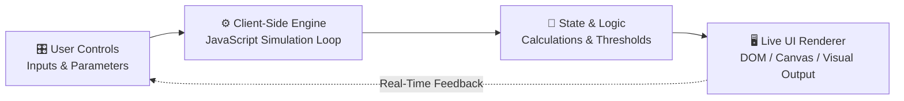

<div align="center">

# ⚡ iKwath Simulator
### Interactive, Zero-Dependency Web-Based Simulation Platform

[](https://developer.mozilla.org/en-US/docs/Web/HTML)
[](https://developer.mozilla.org/en-US/docs/Web/CSS)
[](https://developer.mozilla.org/en-US/docs/Web/JavaScript)
[](https://pages.github.com/)

A lightweight, self-contained browser simulator packed into a single `index.html` (~30 KB) — no build tools, no backend server, and no installation required.

[📌 Overview](#-overview) • [✨ Features](#-key-features) • [🏗️ Architecture](#️-how-it-works) • [🚀 Quick Start](#-quick-start) • [🌐 Live Hosting](#-deploy-in-30-seconds-github-pages)

</div>

---

## 📌 Overview

**iKwath Simulator** is an interactive client-side web simulator built to visualize and test real-time system behavior directly inside any modern browser. Because the entire UI, styling, and simulation engine live inside a single `index.html` file, it runs offline, loads instantaneously, and deploys effortlessly on static hosts like GitHub Pages, Netlify, or Vercel.

> **Note:** Replace this line with a 1–2 sentence summary of what your simulator models (e.g., *process parameters, thermal/sensor curves, or automated control stages*).

---

## ✨ Key Features

* ⚡ **Zero-Dependency Single-File Build:** Complete HTML, CSS, and JavaScript bundled into one portable `index.html` (~30 KB).
* 🎛️ **Interactive Real-Time Controls:** Adjust simulation parameters on the fly and observe immediate visual feedback.
* 📊 **Live Visual Telemetry:** Dynamic state indicators and real-time output updates directly in the browser.
* 📱 **Responsive & Offline-First:** Works across desktop, tablet, and mobile browsers without needing an internet connection or local runtime.
* 🚀 **One-Click Static Deployment:** Ready for instant hosting on GitHub Pages with zero configuration.

---

## 🏗️ How It Works



---

## 📂 Repository Structure

```text
ikwath-simulator-main/
├── index.html      # Complete self-contained simulator (UI + CSS + JS engine, ~30 KB)
└── README.md       # Project documentation
```

---

## 🚀 Quick Start

<details open>
<summary><b>⚡ Option 1: Open Directly in Browser (Fastest)</b></summary>

1. **Clone the repository:**
   ```bash
   git clone [https://github.com/Mr-Alok-404/ikwath-simulator.git](https://github.com/Mr-Alok-404/ikwath-simulator.git)
   cd ikwath-simulator
   ```
2. **Launch the simulator:**
   Double-click `index.html` to open it directly in Chrome, Edge, or Firefox.

</details>

<details>
<summary><b>💻 Option 2: Run with a Local Dev Server</b></summary>

```bash
# Using Python
python -m http.server 8000
```
Then open `http://localhost:8000` in your browser.

</details>

---

## 🌐 Deploy in 30 Seconds (GitHub Pages)

1. Go to your GitHub repository **Settings → Pages**.
2. Under **Build and deployment → Source**, select **Deploy from a branch**.
3. Choose branch `main` and folder `/ (root)`, then click **Save**.
4. Your live simulator will be available at:
   ```text
   [https://mr-alok-404.github.io/ikwath-simulator/](https://mr-alok-404.github.io/ikwath-simulator/)
   ```

---

## 🛠️ Tech Stack

| Layer | Technology |
| :--- | :--- |
| **Structure** | HTML5 |
| **Styling** | CSS3 (Embedded) |
| **Simulation Logic** | Vanilla JavaScript (Embedded) |
| **Hosting** | GitHub Pages / Any Static Host |

---

<div align="center">
  Built with ❤️ • <strong>iKwath Simulator</strong>
</div>
